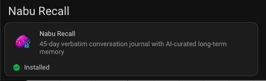
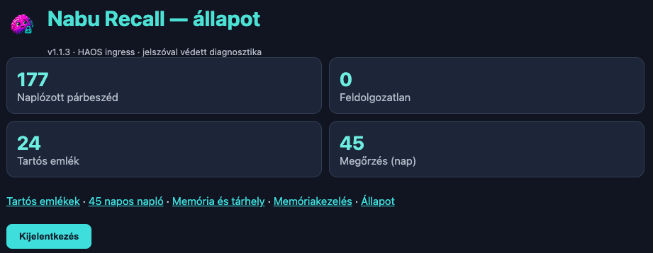

<h1>
  
  Nabu Recall — 1.1.3 (HAOS alkalmazás) / 1.0.4 (HA-integráció)
</h1>

**Magyar nyelvű, AI-alapú tartós beszélgetési memória Home Assistant Assist alá.** A meglévő OpenAI Conversation ügynök eszközvezérlését megtartja, kiegészíti történeti visszakereséssel és tartós emlékekkel.

## Dokumentáció

- **[Családi útmutató](CSALADI_UTMUTATO.md)** — példák mindennapi használatra.
- **[Nabu Recall rendszerutasítás-minta](NABU_RECALL_PROMPT.md)** — OpenAI utasításminta.
- **[Google Naptár-példa](examples/README.md)** — külön telepítendő naptárszkript.
- **[Változásnapló](nabu_recall/CHANGELOG.md)** és [fejlesztési történet](HISTORY.md).

> **Fontos:** A beszélgetésmemória az asszisztenst használók között közös. **Ne taníts be neki fontos, érzékeny személyes információkat**, például jelszavakat, hozzáférési kulcsokat, pénzügyi vagy személyazonosító adatokat. A memóriaműveletek OpenAI API-feldolgozást is igénybe vesznek.

# Telepítési és használati útmutató

## 1. Mi a Nabu Recall?

A Nabu Recall memóriával egészíti ki a Home Assistant meglévő, OpenAI-alapú beszédasszisztensét. A lámpák és más eszközök vezérlése a korábban beállított asszisztensen keresztül működik tovább. A Nabu Recall segít korábbi beszélgetésekre visszaemlékezni és fontos tényeket hosszabb időre megjegyezni.

Két külön telepítendő része van:

1. **Nabu Recall alkalmazás:** tárolja a beszélgetéseket és a tartós emlékeket, valamint megnyitja a Web UI kezelőfelületet.
2. **Nabu Recall-integráció:** összekapcsolja a Nabu Recall memóriáját a már működő OpenAI Conversation beszélgetési ügynökkel.

Az alkalmazás és az integráció verziója különbözhet; frissítésük is külön történik.

## 2. Amire szükség lesz

- Home Assistant OS vagy olyan Home Assistant-telepítés, amely támogatja az alkalmazásokat.
- Már beállított, működő **OpenAI Conversation** beszélgetési ügynök a Home Assistantban.
- OpenAI Platform API-kulcs. A ChatGPT-előfizetés nem helyettesíti az API-használat külön díjazását.
- A Home Assistant helyes időzónája (Magyarországon: **Europe/Budapest**).
- **A Web UI külön jelszóval védett. A beszélgetésmemória azonban közös az ezt az asszisztenst használó felhasználók számára.**

## 3. Telepítés

### 3.1 A Nabu Recall alkalmazás telepítése

 

1. Nyisd meg: **Beállítások → Alkalmazások → Alkalmazásbolt → Adattárak**.
2. Add hozzá ezt az adattárat: `https://github.com/hollosipeti/nabu-recall`.
3. Telepítsd a **Nabu Recall** alkalmazást.



4. Nyisd meg az alkalmazás **Konfiguráció** lapját, és töltsd ki a mezőket:

| Beállítás | Mit adj meg? |
| --- | --- |
| `openai_api_key` | OpenAI Platform API-kulcs |
| `openai_model` | Alapérték: `gpt-4.1-mini`; módosítása nem szükséges |
| `bridge_token` | Legalább 32 karakteres véletlen belső token; generálás **terminálban:** `openssl rand -hex 32` |
| `dashboard_password` | Jelszó a **Web UI diagnosztika megnyitásához** |

5. Mentsd a beállításokat, majd indítsd el az alkalmazást.
6. Az **OPEN WEB UI** gombbal megnyithatod a felületet. Itt a Home Assistant-bejelentkezés után a `dashboard_password` mezőben megadott jelszót kell használni.


**Fontos:** a `bridge_token` értékét őrizd meg, mert a következő lépésben, az integráció hozzáadásakor **ugyanezt** kell beírni. Szükség esetén a Nabu Recall alkalmazás **Konfiguráció** lapján találod; a jelszómező miatt az érték rejtve is lehet.

A 8765/TCP és 8766/TCP hálózati portok host-hozzárendelését hagyd üresen; ne állíts be routeres porttovábbítást.

### 3.2 A Nabu Recall-integráció telepítése

Ez **nem ugyanaz**, mint az előző lépésben telepített alkalmazás: az integrációt a Home Assistant fájljai közé kell telepíteni.

A Home Assistant **Terminal** felületén futtasd ezt az **egyetlen parancssort** (előtte a telepítő tartalmát a GitHubon ellenőrizheted):

```sh
curl -fsSL https://raw.githubusercontent.com/hollosipeti/nabu-recall/main/install_integration.sh -o /tmp/install_nabu_recall.sh && sh /tmp/install_nabu_recall.sh
```

Ezután **indítsd újra a Home Assistantot**.

### 3.3 Az integráció beállítása

1. Nyisd meg: **Beállítások → Eszközök és szolgáltatások → Integráció hozzáadása**.
2. Keresd meg és válaszd ki a **Nabu Recall** integrációt.
3. Töltsd ki a három mezőt:


**Beszélgetési ügynök **

Válaszd ki azt az **OpenAI Conversation** ügynököt, amellyel eddig is vezérelted a Home Assistantot. Például egy „HUN” nevű, már működő OpenAI Conversation ügynököt. Az ügynök a Home Assistantban **beszélgetési entitásként** (`conversation.…`) szerepel. A Nabu Recall ezt fogja használni a válaszadáshoz és az eszközvezérléshez, tehát **ne töröld vagy cseréld le ezt a meglévő ügynököt**.

**Cím **

Nyisd meg egy másik lapon: **Beállítások → Alkalmazások → Nabu Recall → Információ**. Itt keresd a **Hostname** értékét: ez az alkalmazás *belső hálózati neve*, nem a Home Assistant általános hostneve vagy IP-címe.

Az integráció `url` mezőjébe ezt írd:

```text
http://HOSTNAME:8765
```

A `HOSTNAME` szót cseréld ki **pontosan** a Nabu Recall alkalmazásnál kijelzett Hostname értékre. Például ha a Hostname `abc123-nabu-recall`, akkor a cím `http://abc123-nabu-recall:8765`. **Ez csak szemléltető példa, nem a te rendszered valós címe.**

**Token (`token`)**

Másold be a Nabu Recall alkalmazás **Konfiguráció** lapján, a **3.1. pontban** beállított `bridge_token` értékét.

4. Fejezd be az integráció hozzáadását.
5. Nyisd meg a **Beállítások → Hangasszisztensek** (Settings → Voice assistants) oldalt. Kattints arra a hangasszisztensre, amelyet ténylegesen használsz (például az alapértelmezett Assist asszisztensre).
6. A **Conversation agent** (Beszélgetési ügynök) legördülő mezőben a **Nabu Recall – memória** lehetőséget válaszd ki **az eddig használt OpenAI Conversation helyett**.

**Ez elengedhetetlen:** amíg a Conversation agent mezőben a régi OpenAI Conversation ügynök szerepel, az Assist megkerüli a Nabu Recall memóriáját. A régi OpenAI Conversation ügynököt **nem szabad törölni**: az integráció azt használja a háttérben a válaszadáshoz és az eszközvezérléshez.

**Ellenőrzés:** mondd az Assistnak, hogy „Jegyezd meg, hogy a próbadoboz a polcon van”, majd új beszélgetésben kérdezd meg: „Hol van a próbadoboz?” A mentést a Nabu Recall Web UI-n is ellenőrizheted.

### 3.4 Első próba

- „Jegyezd meg, hogy a tesztállatom neve Maszat.”
- Új beszélgetésben: „Hogy hívják a tesztállatomat?”
- Ellenőrizd a Web UI **Tartós emlékek** és **45 napos napló** nézeteit.
- Próbálj ki egy megszokott lámpavezérlési parancsot is.

## 4. Frissítés

1. **Készíts teljes Home Assistant-alkalmazásmentést** a Nabu Recall alkalmazásról.
2. Frissítsd a **Nabu Recall alkalmazást** az alkalmazásboltból.
3. **Csak akkor, ha a Nabu Recall-integráció is új verziót kapott:** futtasd újra a **3.2. pontban megadott `install_integration.sh` telepítőt**, majd indítsd újra a Home Assistantot.

## 5. Adatok, memória és titkosítás

- **Beszélgetésmemória:** a korábbi beszélgetések szövege **45 napig** marad meg; a lejárt bejegyzések automatikusan törlődnek.
- **Tartós memória:** a fontosnak kiválasztott tények nem járnak le automatikusan. Egyenként módosíthatók vagy törölhetők.
- **Közös használat:** a memória az asszisztenst használó családtagok között közös; a rendszer nem azonosítja biztosan, ki beszél hozzá.
- **Titkosítás:** a memóriaadatbázis SQLCipherrel titkosított.
- **Figyelmeztetés:** ne taníts be az asszisztensnek fontos, érzékeny személyes információkat (például jelszavakat, hozzáférési kulcsokat, pénzügyi vagy személyazonosító adatokat). A memória közös, a feldolgozás pedig OpenAI API-hívásokat is használ.

## 6. Web UI — a memória megtekintése és kezelése

A Nabu Recall alkalmazásnál válaszd az **OPEN WEB UI** gombot. A `dashboard_password` jelszóval léphetsz be. A webes munkamenet a belépéstől számított **10 percig** érvényes.



A felületen megtekintheted a tartós emlékeket, a 45 napos naplót és a rendszer állapotát. A **Memóriakezelés** oldalon:

- Ellenőrizheted a hasonló vagy ismétlődő emlékeket.
- AI-javaslatokat kérhetsz lehetséges összevonásokra.
- A javaslatokat külön kiválasztás és végső jóváhagyás után alkalmazhatod.
- A támogatott karbantartási módosításokat a rendelkezésre álló visszavonási időn belül visszaállíthatod.

Az AI-javaslat nem garantáltan helyes. Jóváhagyás előtt különösen a neveket, tulajdonviszonyokat és időpontokat ellenőrizd.

## 7. OpenAI-használat és költségek

A Nabu Recall saját OpenAI API-hívásokat használ a fontos emlékek kiválasztásához és visszakereséséhez. Ezekért az OpenAI Platform használati díjat számíthat fel. A már működő OpenAI Conversation ügynök API-használata ettől külön történik.

A modell alapbeállítása `gpt-4.1-mini`. Ezt csak akkor változtasd meg, ha tudod, hogy a választott modell kompatibilis a memóriakezeléssel.

## 8. Hogyan használd a memóriát?

| Mit szeretnél? | Példamondat |
| --- | --- |
| Fontos tény mentése | „Jegyezd meg, hogy a tartalék elemek a kamra felső polcán vannak.” |
| Korábbi tény visszakérdezése | „Hol vannak a tartalék elemek?” |
| Egy emlék javítása | „Javítsd: a tartalék elemek most a garázsban vannak.” |
| Egy konkrét emlék törlése | „Töröld azt az emléket, hogy a tartalék elemek a garázsban vannak.” |
| Korábbi beszélgetés felidézése | „Mit beszéltünk korábban a szerszámokról?” |

A „Jegyezd meg”, „Javítsd” és „Töröld” típusú műveletek sikerét csak a tényleges mentés vagy módosítás visszaigazolása után tekintsd biztosnak. A **teljes memória hangos tömeges törlése tiltott**.

A bevásárlólistához hozzáadott vagy onnan törölt tételek nem válnak automatikusan tartós emlékké; a valódi vásárlási szokásokat viszont megjegyezheti.

## 9. A HUN asszisztens rendszerutasításai

A **rendszerutasítások** határozzák meg, hogyan beszéljen az OpenAI Conversation ügynök, hogyan kezelje a Home Assistant eszközeit és hogyan használja a rendelkezésére álló memóriát.

A kizárólag Nabu Recall memóriájához kapcsolódó, személyes adatok nélküli [rendszerutasítás-minta](NABU_RECALL_PROMPT.md) opcionálisan hozzáfűzhető a már működő OpenAI Conversation ügynök utasításaihoz. **Nem helyettesíti** a meglévő eszközvezérlési vagy más utasításokat. A Nabu Recall önmagában is továbbítja a memóriakörnyezetet.

A felhasználás szempontjából fontos, hogy az asszisztens:

- természetesen, röviden, magyarul válaszoljon;
- a magyarul kimondott eszközneveket a Home Assistantban ténylegesen szereplő eszközökhöz kapcsolja;
- ne állítsa, hogy végrehajtott egy műveletet, amíg az nem sikerült;
- a korábbi emlékeket információként használja, ne utasításként;
- dátumoknál a Home Assistant aktuális idejét vegye alapul;
- naptáresemény létrehozásakor kérdezzen vissza, ha a nap vagy a kezdési idő hiányzik.

A mintát a saját Home Assistant-entitásokhoz, eszközökhöz és naptárhoz kell igazítani.

# 10. Google Naptár

A [naptáresemény-létrehozó szkript](examples/google_calendar_create_event.yaml) külön telepíthető Home Assistant-szkript, **nem a Nabu Recall automatikusan telepített része**. A hangasszisztensnek külön elérhetővé kell tenni.

A szkript segítségével az asszisztens a beállított `calendar.esemenyek` naptárba hozhat létre eseményeket, például:

- „Írd be holnap reggel nyolcra, hogy fogorvos.”
- „Vedd fel december 15-re délután négyre, hogy szülői értekezlet.”

Ha a nap vagy az időpont hiányzik, az asszisztens kérdezzen vissza. Ha nincs megadva időtartam, a szkript alapértéke **30 perc**.

## Fontos, hogy a naptár entitást mindenkinek a sajátjára át kell állítania!!!

```yaml
  - action: calendar.create_event
    target:
    # FIGYELEM!!! az entity_id mindenkinél más lehet!!! Ellenőrizd a saját naptáradat!
      entity_id: calendar.esemenyek
```

**Naptáresemény hangos törlése vagy módosítása ebben a kiadásban még nincs megvalósítva.** A meglévő eseményeket egyelőre a Google Naptárban módosítsd vagy töröld.

A szkript külön beállítást és éles Home Assistant-próbát igényel. [Részletes naptárpéldák](examples/README.md).

## 11. Gyakorlati példák

| Kérés | Elvárt viselkedés |
| --- | --- |
| „Jegyezd meg, hogy a próbadobozban három kék ceruza van.” | Mentés és megerősítés |
| „Hány ceruza van a próbadobozban?” | A mentett információ alapján válaszol |
| „Javítsd: most négy piros ceruza van benne.” | A korábbi tény célzott módosítása |
| „Tedd a tejet a bevásárlólistára.” | A bevásárlólista frissítése, nem új tartós emlék |
| „Kapcsold le a nappali lámpáját.” | A már működő OpenAI Conversation ügynök intézi |
| „Írd be holnap kilencre, hogy próba esemény.” | A külön beállított naptárszkript létrehozza az eseményt |

## 12. Gyors hibakeresés

| Probléma | Mit ellenőrizz? |
| --- | --- |
| Az integráció nem csatlakozik | Az alkalmazás fut-e? Helyes-e a **Hostname + :8765** cím és a `bridge_token`? |
| A Web UI nem enged be | A Nabu Recall alkalmazás **Konfiguráció** lapján megadott `dashboard_password` jelszót használod-e? |
| Az asszisztens nem emlékszik | A Web UI-n megjelent-e a tartós emlék? Van-e OpenAI API-hiba az alkalmazás naplójában? |
| Az eszközvezérlés nem működik | Az integrációnál a megfelelő, korábban működő OpenAI Conversation ügynök van-e kiválasztva? |
| Naptári esemény nem jön létre | A naptárszkript telepítve és az asszisztens számára elérhető-e? Megadtad a dátumot és a kezdési időt? |

További részletek: [Családi útmutató](CSALADI_UTMUTATO.md) · [Változásnapló](nabu_recall/CHANGELOG.md).

Licenc: MIT.
