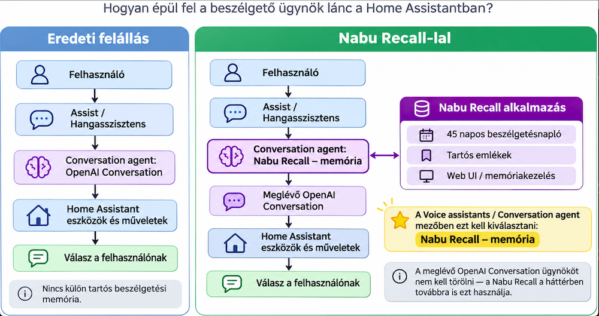
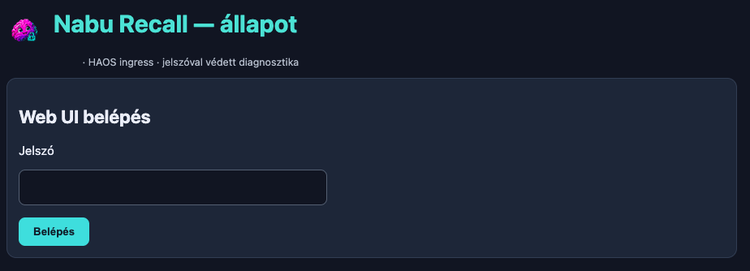
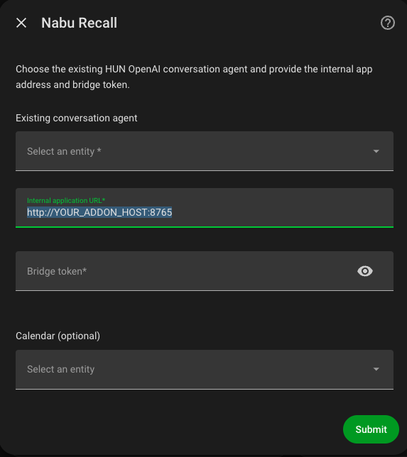

<h1>
  
  Nabu Recall — HAOS alkalmazás és HA integráció
</h1>

| Komponens | Legfrissebb, élesben ellenőrzött verzió |
| --- | --- |
| Nabu Recall HAOS alkalmazás (APP) | **2.0.1** |
| Nabu Recall HA-integráció | **2.0.2** |

**Magyar nyelvű, AI-alapú tartós beszélgetési memória Home Assistant Assist alá.** A meglévő OpenAI Conversation ügynök eszközvezérlését megtartja, kiegészíti történeti visszakereséssel és tartós emlékekkel.

## Dokumentáció

- **[Családi útmutató](CSALADI_UTMUTATO.md)** — példák mindennapi használatra.
- **[Az összes aktív OpenAI-utasítás pontos helye](NABU_RECALL_PROMPT.md)** — forrásfájlok, telepítési útvonalak, felhasználói HA-utasításokkal való összevetés.
- **[Változásnapló](nabu_recall/CHANGELOG.md)** és [fejlesztési történet](HISTORY.md).

> **Fontos!!! A beszélgetésmemória az asszisztenst használók között közös. Ne taníts be neki fontos, érzékeny személyes információkat, például jelszavakat, hozzáférési kulcsokat, pénzügyi vagy személyazonosító adatokat. A memóriaműveletek OpenAI API-feldolgozást is igénybe vesznek.**

# Telepítési és használati útmutató

## 1. Mi a Nabu Recall?

A Nabu Recall memóriával egészíti ki a Home Assistant meglévő, OpenAI-alapú beszédasszisztensét. A lámpák és más eszközök vezérlése a korábban beállított asszisztensen keresztül működik tovább. A Nabu Recall segít korábbi beszélgetésekre visszaemlékezni és fontos tényeket hosszabb időre megjegyezni.



Két külön telepítendő része van:

1. **Nabu Recall alkalmazás:** tárolja a beszélgetéseket és a tartós emlékeket, valamint megnyitja a Web UI kezelőfelületet.
2. **Nabu Recall-integráció:** összekapcsolja a Nabu Recall memóriáját a már működő OpenAI Conversation beszélgetési ügynökkel.

Az alkalmazás és az integráció verziója különbözhet; frissítésük is külön történik.

## 2. Amire szükség lesz

- Home Assistant OS vagy olyan Home Assistant-telepítés, amely támogatja az alkalmazásokat.
- Már beállított, működő **OpenAI Conversation** beszélgetési ügynök a Home Assistantban. OpenAI Platform API-kulcs. (A ChatGPT-előfizetés nem helyettesíti az API-használat külön díjazását.)
- A Home Assistant helyes időzónája (Magyarországon: **Europe/Budapest**).
- Opcionálisan Google Calendar integrációra

## 3. Telepítés

### 3.1 A Nabu Recall alkalmazás telepítése

 

1. Nyisd meg: **Settings > Apps > Install app > ⋮ > Repositories.**
2. Add hozzá ezt az adattárat: `https://github.com/hollosipeti/nabu-recall`.
3. Telepítsd a **Nabu Recall** alkalmazást.


4. Nyisd meg az alkalmazás **Konfiguráció** lapját, és töltsd ki a mezőket:

| Beállítás | Mit adj meg? |
| --- | --- |
| `openai_api_key` | OpenAI Platform API-kulcs |
| `openai_model` | Alapérték: `gpt-4.1-mini`; módosítása nem szükséges |
| `bridge_token` | Legalább 32 karakteres véletlen belső token; generálás **terminálban:** `openssl rand -hex 32` |
| `dashboard_password` | Jelszó a **Web UI diagnosztika megnyitásához** |

5. Mentsd a beállításokat, majd indítsd el az alkalmazást.
6. Az **OPEN WEB UI** gombbal megnyithatod a felületet. Itt a `dashboard_password` mezőben megadott jelszót kell használni.



**Fontos:** a `bridge_token` értékét őrizd meg, mert a következő lépésben, az integráció hozzáadásakor **ugyanezt** kell beírni. Szükség esetén a Nabu Recall alkalmazás **Konfiguráció** lapján találod; a jelszómező miatt az érték rejtve is lehet.

A 8765/TCP és 8766/TCP hálózati portok host-hozzárendelését hagyd üresen; ne állíts be routeres porttovábbítást.

### 3.2 A Nabu Recall-integráció telepítése

Ez **nem ugyanaz**, mint az előző lépésben telepített alkalmazás: az integrációt a Home Assistant fájljai közé kell telepíteni.

A Home Assistant **Terminal** felületén futtasd ezt az **egyetlen parancssort** (előtte a telepítő tartalmát a GitHubon ellenőrizheted):

```sh
curl -fsSL https://raw.githubusercontent.com/hollosipeti/nabu-recall/main/install_integration.sh -o /tmp/install_nabu.sh && sh /tmp/install_nabu.sh main
```

A parancs kizárólag a HA-integrációt telepíti vagy cseréli le, nem az APP-ot és nem annak adatait.

Ezután **indítsd újra a Home Assistant Core-t** (a terminálból: `ha core restart`).

### 3.3 Az integráció beállítása

1. Nyisd meg: **Settings > Devices & services > Add integration**.
2. Keresd meg és válaszd ki a **Nabu Recall** integrációt.
3. Töltsd ki a meglévő ügynök, belső URL és token mezőjét. **Opcionálisan válassz egy naptár-entitást** (pl. `calendar.esemenyek`). Ha üresen hagyod, a Nabu Recall naptárfunkciói kikapcsolva maradnak:



## Beszélgetési ügynök:

Válaszd ki azt az **OpenAI Conversation** ügynököt, amellyel eddig is vezérelted a Home Assistantot. Például egy „HUN” nevű, már működő OpenAI Conversation ügynököt. Az ügynök a Home Assistantban **beszélgetési entitásként** (`conversation.…`) szerepel. A Nabu Recall ezt fogja használni a válaszadáshoz és az eszközvezérléshez, tehát **ne töröld vagy cseréld le ezt a meglévő ügynököt**.

## URL Cím:

Nyisd meg egy másik lapon: **Beállítások → Alkalmazások → Nabu Recall → Információ**. Itt keresd a **Hostname** értékét: ez az alkalmazás *belső hálózati neve*, nem a Home Assistant általános hostneve vagy IP-címe.

Az integráció `url` mezőjébe ezt írd:

```text
http://HOSTNAME:8765
```

A `HOSTNAME` szót cseréld ki **pontosan** a Nabu Recall alkalmazásnál kijelzett Hostname értékre. Például ha a Hostname `abc123-nabu-recall`, akkor a cím `http://abc123-nabu-recall:8765`. **Ez csak szemléltető példa, nem a te rendszered valós címe.**

## Token:

Másold be a Nabu Recall alkalmazás **Konfiguráció** lapján, a **3.1. pontban** beállított `bridge_token` értékét.

## Calendar: (opcionális)

Válaszd ki a használni kivánt naptárt.

4. Fejezd be az integráció hozzáadását.
5. Nyisd meg a **Beállítások → Hangasszisztensek** (Settings → Voice assistants) oldalt. Kattints arra a hangasszisztensre, amelyet ténylegesen használsz (például az alapértelmezett Assist asszisztensre).
6. A **Conversation agent** (Beszélgetési ügynök) legördülő mezőben a **Nabu Recall – memória** lehetőséget válaszd ki az eddig használt OpenAI Conversation helyett. Ez elengedhetetlen: amíg a Conversation agent mezőben a régi OpenAI Conversation ügynök szerepel, az Assist megkerüli a Nabu Recall memóriáját. A régi OpenAI Conversation ügynököt **nem szabad törölni**: az integráció azt használja a háttérben a válaszadáshoz és az eszközvezérléshez.

**Ellenőrzés:** mondd az Assistnak, hogy „Jegyezd meg, hogy a próbadoboz a polcon van”, majd új beszélgetésben kérdezd meg: „Hol van a próbadoboz?” A mentést a Nabu Recall Web UI-n is ellenőrizheted.

### 3.4 Első próba

- „Jegyezd meg, hogy a tesztállatom neve Maszat.”
- Új beszélgetésben: „Hogy hívják a tesztállatomat?”
- Ellenőrizd a Web UI **Tartós emlékek** és **45 napos napló** nézeteit.
- Próbálj ki egy megszokott lámpavezérlési parancsot is.

## 4. Frissítés

Az APP és a HA-integráció egymástól függetlenül frissíthető. Nem kell mindkettőt újratelepíteni, ha csak az egyik változott.

1. Készíts Home Assistant-mentést, benne a Nabu Recall alkalmazással, annak adataival és az integráció konfigurációjával. Részletek: [Biztonsági mentés és karbantartás](docs/SAFE_CLEANUP_HU.md).
2. Ha az **APP** kapott új verziót, frissítsd a meglévő alkalmazást az alkalmazásboltból.
3. Ha a **HA-integráció** kapott új, a GitHub `main` ágán ténylegesen elérhető verziót, futtasd újra a 3.2. pont telepítőparancsát, majd indítsd újra a HA Core-t.
4. Ellenőrizd a két verziószámot, a memóriaadatokat, az eszközvezérlést és (ha be van állítva) a naptárt.

A frissítéseihez nem szükséges új adatbázist létrehozni vagy a meglévő memóriát törölni.

## 5. Adatok, memória és titkosítás

- **Beszélgetésmemória:** a korábbi beszélgetések szövege **45 napig** marad meg; a lejárt bejegyzések automatikusan törlődnek.
- **Tartós memória:** a fontosnak kiválasztott tények nem járnak le automatikusan. Egyenként módosíthatók vagy törölhetők.
- **Közös használat:** a memória az asszisztenst használó családtagok között közös; a rendszer nem azonosítja biztosan, ki beszél hozzá.
- **Titkosítás:** a memóriaadatbázis SQLCipherrel titkosított.
- **Figyelmeztetés:** ne taníts be az asszisztensnek fontos, érzékeny személyes információkat (például jelszavakat, hozzáférési kulcsokat, pénzügyi vagy személyazonosító adatokat). A memória közös, a feldolgozás pedig OpenAI API-hívásokat is használ.

## 6. Web UI — a memória megtekintése és kezelése

A Nabu Recall alkalmazásnál válaszd az **OPEN WEB UI** gombot. A `dashboard_password` jelszóval léphetsz be. A webes munkamenet a belépéstől számított **10 percig** érvényes.


A felületen megtekintheted a tartós emlékeket, a 45 napos naplót és a rendszer állapotát. A **Memóriakezelés** oldalon:

- Ellenőrizheted a hasonló vagy ismétlődő emlékeket.
- AI-javaslatokat kérhetsz lehetséges összevonásokra.
- A javaslatokat külön kiválasztás és végső jóváhagyás után alkalmazhatod.
- A támogatott karbantartási módosításokat a rendelkezésre álló visszavonási időn belül visszaállíthatod.

Az AI-javaslat nem garantáltan helyes. Jóváhagyás előtt különösen a neveket, tulajdonviszonyokat és időpontokat ellenőrizd.

## 7. OpenAI-használat és költségek

A Nabu Recall saját OpenAI API-hívásokat használ a fontos emlékek kiválasztásához és visszakereséséhez. Ezekért az OpenAI Platform használati díjat számíthat fel. A már működő OpenAI Conversation ügynök API-használata ettől külön történik.

A modell alapbeállítása `gpt-4.1-mini`. Ezt csak akkor változtasd meg, ha tudod, hogy a választott modell kompatibilis a memóriakezeléssel.

## 8. Hogyan használd a memóriát?

| Mit szeretnél? | Példamondat |
| --- | --- |
| Fontos tény mentése | „Jegyezd meg, hogy a tartalék elemek a kamra felső polcán vannak.” |
| Korábbi tény visszakérdezése | „Hol vannak a tartalék elemek?” |
| Egy emlék javítása | „Javítsd: a tartalék elemek most a garázsban vannak.” |
| Egy konkrét emlék törlése | „Töröld azt az emléket, hogy a tartalék elemek a garázsban vannak.” |
| Korábbi beszélgetés felidézése | „Mit beszéltünk korábban a szerszámokról?” |

A „Jegyezd meg”, „Javítsd” és „Töröld” típusú műveletek sikerét csak a tényleges mentés vagy módosítás visszaigazolása után tekintsd biztosnak. A **teljes memória hangos tömeges törlése tiltott**.

A bevásárlólistához hozzáadott vagy onnan törölt tételek nem válnak automatikusan tartós emlékké; a valódi vásárlási szokásokat viszont megjegyezheti.

## 8.1 Forgó memória – kiválasztott beszélgetések végleges törlése (2.0.1)

A 2.0.1-es alkalmazástól a **Web UI → Memóriakezelés → Forgó memória – kiválasztás és végleges törlés** lapon a korábbi párbeszédek kézzel kiválaszthatók és végleg törölhetők.

- Keresés a kérdések és válaszok szövegében, dátumszűrés a Home Assistant magyar időzónájában, 40 soros lapozás.
- Minden párbeszéd mellett pipa; az aktuális oldalon a törölhető sorok külön gombbal kijelölhetők. **Semmi nincs előre kijelölve, és nincs automatikus tesztadat-felismerés vagy -törlés.**
- A feldolgozatlan sorok és az aktív tartós emlékek `source_turn` hivatkozásai által védett sorok nem törölhetők. Vegyes, védett tételt tartalmazó kijelölés teljes egészében elutasításra kerül.
- Az előnézet megmutatja a kiválasztott sorok pontos tartalmát; külön megerősítés és jelölőnégyzet szükséges. Egyszerre legfeljebb 40 párbeszéd végleg törölhető.
- **Nem archiválás, nincs alkalmazáson belüli visszaállítás.** A kijelölt bejegyzések az aktív titkosított adatbázisból törlődnek. A SQLite WAL-t a rendszer ellenőrzőpontozza; régebbi HA biztonsági mentésekben ettől még megmaradhatnak a korábbi adatok.
- Törlés előtt készíts teljes, ellenőrzött HA-mentést. A tartós emlékek és a 45 napos normál lejárat logikája változatlan.

Ez az **APP 2.0.1** funkciója; a HA-integrációt nem szükséges hozzá frissíteni. A 2.0.2-es naptárjavítás sem változtatja meg ezt a funkciót.

## 9. Nabu Recall AI-utasítások: csak a repóban

A Nabu Recall memória- és válaszadási utasításait az integráció saját `custom_components/nabu_recall/repo_instructions.py` fájlja tartalmazza, és automatikusan továbbítja a meglévő OpenAI Conversation ügynöknek. **A Home Assistantban nem kell kézzel másolni vagy szerkeszteni a Nabu Recall promptját.**

A naptáreszközök külön utasításai a `custom_components/nabu_recall/llm.py`, a memóriafeldolgozásé a `nabu_recall/ai.py` részei, szintén a GitHubon verziózva. Az [utasítások forrástérképe](NABU_RECALL_PROMPT.md) az összes aktív fájlt és a telepítési helyüket mutatja; a régi másolandó promptmintát eltávolítottuk.

**Fontos technikai határ:** az eredeti Home Assistant OpenAI Conversation ügynöknek továbbra is van saját szerkeszthető általános rendszerutasítása. A Nabu Recall azt nem törli vagy írja át, mert az az eredeti HA-funkciókat is érintené. Az általános HA/eszközvezérlési szabályok maradhatnak, a régi Nabu-memória- és naptárutasításokat viszont ne duplikáld benne.

## 10. Opcionális, beépített naptár

A Nabu Recall a Home Assistantban már elérhető naptár-entitással dolgozik. Nem kell külön YAML-t vagy naptárszkriptet telepíteni. A naptár nélküli telepítés továbbra is teljes értékű tartós memória.

### Beállítás

- Nyisd meg: Beállítások → Eszközök és szolgáltatások → Nabu Recall → Konfigurálás / Beállítások → **Naptár (opcionális)**. Válassz egy naptár-entitást (pl. `calendar.esemenyek`). Ha üresen hagyod, a naptárfunkciók kikapcsolva maradnak.
- A meglévő OpenAI Conversation ügynöknél legyen engedélyezve a Home Assistant **Assist (eszközvezérlés)** LLM API.
- A kiválasztott naptárt nem szükséges külön kitenni (Expose) a natív Assist naptáreszköznek. Ha korábban kitetted, az eszközütközések elkerüléséhez vedd ki a natív Assist-kitettségből. Ettől a naptár és a Nabu Recall hozzáférése nem törlődik.
- A régi kézi naptárszkriptek Assist-kitettségére és a régi naptárutasításokra nincs szükség. Ha korábban beállítottad őket, szüntesd meg a kettős vezérlést; a meglévő szkripteket nem kell törölni.

### Működés és példák

| Mit szeretnél? | Példamondat | HA-integráció |
| --- | --- | --- |
| Mai programok | „Mi van mára a naptáramban?” | 2.0.0-tól |
| Következő esemény | „Mi lesz a következő programom?” | 2.0.0-tól |
| Konkrét nap vagy hétvége | „Van valami programom a hétvégén?” | 2.0.0-tól |
| Időzített esemény | „Írd be a naptáramba, hogy holnap háromtól négyig megbeszélésem lesz.” | 2.0.0-tól |
| Jövő hét | „Milyen programjaim lesznek jövő héten?” | 2.0.2 |
| Tetszőleges időszak | „Van valami programom a következő két hétben?” | 2.0.2 |
| Teljes hónap | „Milyen elfoglaltságaim lesznek decemberben?” | 2.0.2 |
| Két megadott dátum között | „Mi van a naptáramban november 28. és december 8. között?” | 2.0.2 |
| Név szerinti keresés | „Mikor megyek fogorvoshoz, és meddig tart?” | 2.0.2 |
| Egész napos esemény | „December 6-án egész nap szabadságon leszek. Írd be a naptáramba!” | 2.0.2 |
| Többnapos esemény | „December 11-től 14-ig szabadságon leszek. Írd be a naptáramba!” | 2.0.2 |
| Éjfélen átnyúló esemény | „December 9-én este tizenegytől másnap hajnali egyig karbantartás lesz. Írd be a naptáramba!” | 2.0.2 |

A 2.0.0 is támogatja a mai, holnapi, hétvégi, konkrét napi és következő hét napos lekérdezést, valamint a következő eseményt és az időzített eseménylétrehozást. A 2.0.2-ben javult a magyar dátumok és időpontok értelmezése, az azonos órán belüli események kezelése, továbbá valódi egész napos és többnapos naptárbejegyzések hozhatók létre.

A jövő hét hétfőtől vasárnapig tart; a következő két hét a mai naptól számított 14 naptári nap. A két konkrét dátum között kért lekérdezésnél mindkét határnap beleszámít. A név szerinti keresés alapértelmezésben 365 napra előre keres a naptári események címében; megadható szűkebb időszak is.

Ha egy időzített eseményhez nincs befejezés vagy időtartam megadva, az alapértelmezés 30 perc. Ha hiányzik a szükséges dátum vagy időpont, illetve ellentmondás van a kérésben, az asszisztensnek pontosítást kell kérnie. Fontos eseménynél mindig ellenőrizd a tényleges naptárbejegyzést.

**Korlátok:** a Nabu Recall csak a kiválasztott naptárat kezeli. Naptári események törlése és módosítása nem támogatott; ezeket a naptár saját felületén végezd el. A naptári események és a tartós emlékek külön kezelendők.

**Verzió:** a 2.0.2-es integráció a GitHub `main` ágáról telepíthető.

## 11. Gyakorlati példák

| Kérés | Elvárt viselkedés |
| --- | --- |
| „Jegyezd meg, hogy a próbadobozban három kék ceruza van.” | Mentés és megerősítés |
| „Hány ceruza van a próbadobozban?” | A mentett információ alapján válaszol |
| „Javítsd: most négy piros ceruza van benne.” | A korábbi tény célzott módosítása |
| „Tedd a tejet a bevásárlólistára.” | A bevásárlólista frissítése, nem új tartós emlék |
| „Kapcsold le a nappali lámpáját.” | A már működő OpenAI Conversation ügynök intézi |
| „Írd be holnap kilencre, hogy próba esemény.” | Az integráció naptáreszköze létrehozza az eseményt, ha a naptár be van állítva |

## 12. Gyors hibakeresés

| Probléma | Mit ellenőrizz? |
| --- | --- |
| Az integráció nem csatlakozik | Az alkalmazás fut-e? Helyes-e a **Hostname + :8765** cím és a `bridge_token`? |
| A Web UI nem enged be | A Nabu Recall alkalmazás **Konfiguráció** lapján megadott `dashboard_password` jelszót használod-e? |
| Az asszisztens nem emlékszik | A Web UI-n megjelent-e a tartós emlék? Van-e OpenAI API-hiba az alkalmazás naplójában? |
| Az eszközvezérlés nem működik | Az integrációnál a megfelelő, korábban működő OpenAI Conversation ügynök van-e kiválasztva? |
| Naptári esemény nem jön létre | Van-e kiválasztott naptár, engedélyezett-e az Assist LLM API, és megadtad-e a szükséges dátumot (időzített eseménynél kezdési időt is)? A naptár támogatja-e az eseménylétrehozást? |
| A kibővített naptárfunkciók nem működnek | Ellenőrizd a HA-integráció verzióját: ezekhez a 2.0.2-es javítás szükséges. Az APP 2.0.1 verziója önmagában nem elegendő. |

További részletek: [Családi útmutató](CSALADI_UTMUTATO.md) · [Változásnapló](nabu_recall/CHANGELOG.md).

Licenc: MIT.
